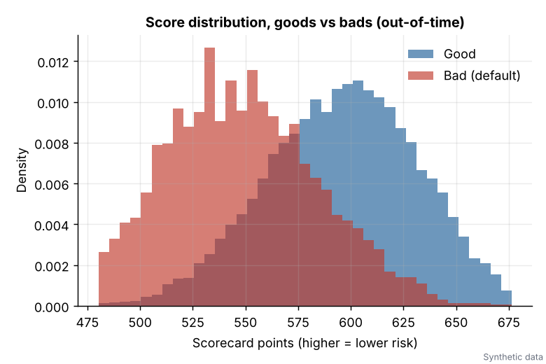
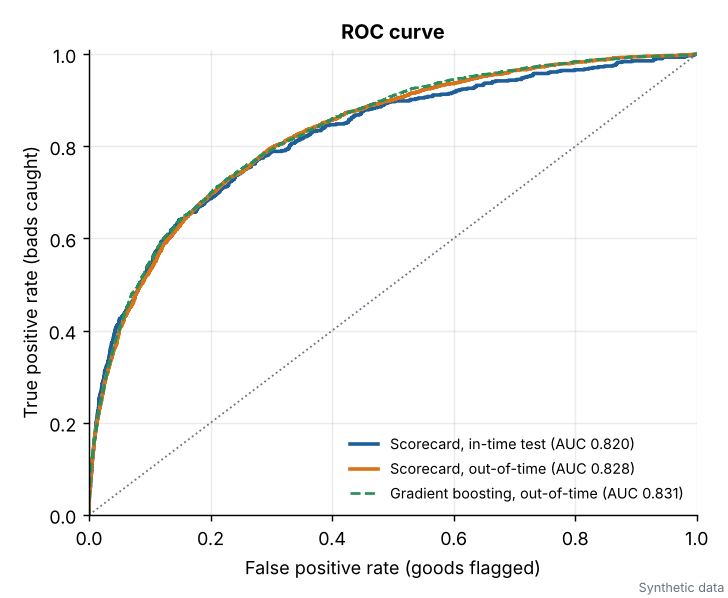
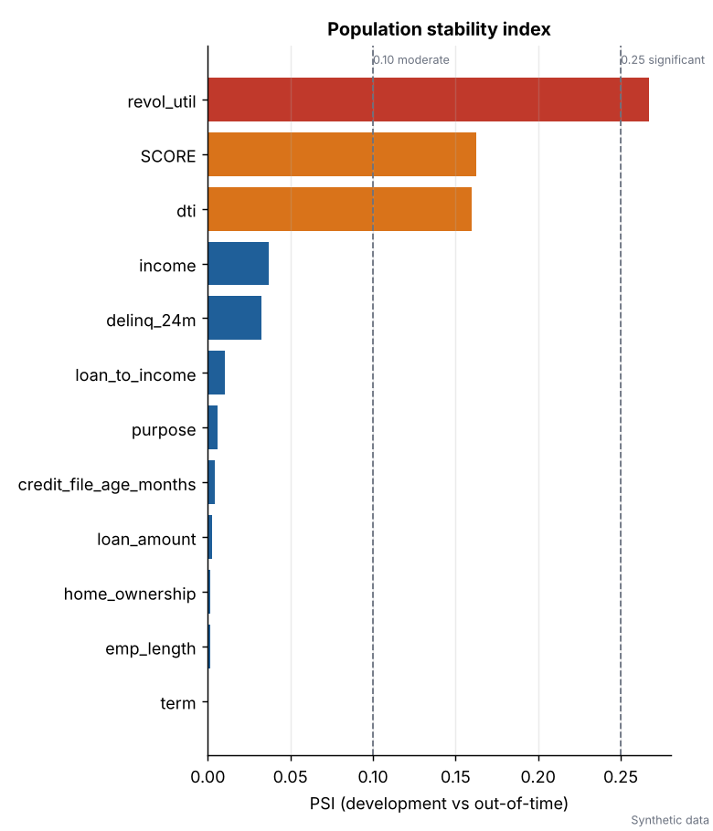

# credit-risk-scorecard

[](https://github.com/adhamkarim4815/credit-risk-scorecard/actions/workflows/ci.yml)


**An end-to-end retail credit risk (probability of default) scorecard, built the way a bank model team
would build it, and validated the way a model risk team would challenge it.** One command generates a
60,000 loan synthetic portfolio with a *known* default process, audits the data, bins and selects
characteristics by weight of evidence, fits a logistic regression by hand-written IRLS, scales it to
a points scorecard, validates it out of time, turns it into cutoff, expected loss and IFRS 9 style
numbers, and writes a model development report with charts.





Everything statistical is implemented from first principles (WoE and monotonic binning, IRLS with
Wald statistics, AUC, KS, PSI, calibration, bootstrap intervals) and checked by 150+ tests against
hand-computed cases and independent references (scipy, and scikit-learn when installed).

> All data is **synthetic**. The default process is planted and known, so results can be compared with
> the truth. Nothing here describes a real lender, customer or portfolio.

## Headline results

Full run on the shipped dataset (seed 20260101), about 15 seconds on a laptop.
Development window 2021 to 2022, out-of-time sample is calendar 2023, which has a planted macro shock.

| Metric | Train | In-time test | Out-of-time |
|---|---|---|---|
| Loans | 25,671 | 11,002 | 23,321 |
| Observed bad rate | 5.41% | 5.64% | 12.11% |
| **AUC** | 0.821 | 0.820 | **0.828** (95% CI 0.819 to 0.835) |
| **Gini** | 0.641 | 0.640 | 0.655 |
| **KS** | 0.496 | 0.496 | **0.501** |
| Score PSI vs train | n/a | 0.001 | **0.163** (moderate shift) |

| Out-of-time comparison | AUC | KS |
|---|---|---|
| Scorecard (11 characteristics, interpretable) | 0.828 | 0.501 |
| Gradient boosting challenger (raw features) | 0.831 | 0.502 |
| Oracle: the true planted PD (not attainable) | 0.848 | 0.535 |

* The scorecard gives up **0.0035 AUC** to gradient boosting (paired bootstrap 95% interval 0.0004 to 0.0065)
  while keeping auditable points and reason codes.
* Ranking power holds out of time, but **calibration does not**: mean predicted PD is 8.7% against an
  observed 12.1% because of the macro shock. The report diagnoses it (Hosmer-Lemeshow, decile table) and
  shows a single logit shift restores calibration-in-the-large.
* PSI correctly lights up the cause: `revol_util` (0.27, significant) and `dti` (0.16, moderate) drifted.
* The profit-maximising cutoff, chosen on the in-time test sample only, is 545 points. Applied
  out of time it approves 86.6% of applicants at a 7.0% bad rate.

<p align="center">
  
  
</p>

More charts in [`docs/`](docs): KS, decile calibration, score distribution of goods versus bads, cutoff versus
profit, and a WoE binning example. The full write-up is
[`docs/model_development_report.md`](docs/model_development_report.md).

## Quick start

```bash
git clone https://github.com/adhamkarim4815/credit-risk-scorecard.git
cd credit-risk-scorecard
pip install -e ".[dev]"      # numpy, scipy, pandas, matplotlib (+ scikit-learn, pytest, ruff)

credit-scorecard run-all     # data, train, validate, charts, report (about 15 s)
python -m pytest             # 150+ tests
```

scikit-learn is optional. Without it the gradient boosting challenger and the sklearn cross-check are
skipped and everything else runs.

Individual stages:

```bash
credit-scorecard generate                      # synthetic CSV into data/
credit-scorecard train                         # quality checks, binning, selection, fit, scorecard.json
credit-scorecard validate                      # metrics, PSI, challenger, business layer, PNG charts
credit-scorecard report                        # docs/model_development_report.md
credit-scorecard score --input applicants.csv --output scored.csv   # score + PD + top 3 reason codes
```

Example of `credit-scorecard score` output (first reason codes shown):

```
loan_id  score      pd  reason_1                                           reason_2
L043791  565.7 0.09874  R03 High debt relative to income (-38 pts)         R04 Income level (-30 pts)
L052545  577.6 0.06753  R02 High utilisation of revolving credit (-38 pts) R08 Requested amount high relative to income (-22 pts)
L049595  666.5 0.00331  R05 Short length of employment (-12 pts)           R11 Housing status (-11 pts)
```

## Pipeline

```mermaid
flowchart LR
    G[generate<br/>synthetic loans<br/>planted PD process] --> Q[data quality<br/>missingness, outliers,<br/>duplicates, leakage,<br/>vintage target rates]
    Q --> C[clean<br/>remediate and split<br/>train / test / out-of-time]
    C --> B[WoE binning<br/>monotonic, min size,<br/>missing bin]
    B --> S[IV selection<br/>correlation pruning]
    S --> M[logistic IRLS<br/>Wald z, sign checks,<br/>VIF]
    M --> P[scorecard<br/>600 pts at 30:1,<br/>PDO 20, reason codes]
    P --> V[validation<br/>AUC Gini KS, calibration,<br/>lift, PSI, bootstrap,<br/>challenger]
    V --> R[business layer<br/>cutoff profit, EL, IFRS 9<br/>illustration]
    R --> D[report + charts<br/>docs/]
```



## Methodology summary

* **Synthetic data** (`generate.py`): 60,000 loans over 36 monthly vintages. The default log-odds is a
  planted model with a saturating delinquency effect, convex utilisation, a hinge on DTI, three
  interactions (utilisation x DTI, long term x loan-to-income, delinquencies x renting), unobserved
  heterogeneity, a macro term (unemployment rising through 2023) and applicant-mix drift. Missingness is
  not at random (high utilisation is more likely to be missing). A few data quality problems are planted
  for the checker: duplicate rows, impossible ages, negative and sentinel incomes, a sentinel utilisation
  code, an invalid loan term, inconsistent employment length, a leaky post-origination column and a
  month of simulated feed outage.
* **Data quality** (`quality.py`): missingness with informativeness test, domain range rules, sentinel
  and 3 x IQR outliers, duplicate keys, a leakage screen (single-variable AUC plus a name screen), and
  volume and target rate by vintage. Findings drive a documented cleaning step.
* **Binning and selection** (`binning.py`, `selection.py`): WoE = ln(%good / %bad). Numeric features
  start from quantile pre-bins, are made strictly monotone by pooling adjacent violators, merged
  for minimum bin size and class counts, and capped at 6 bins by least IV loss. Missing and unseen
  values get their own bin. Selection is by IV with correlation pruning on the WoE scale.
* **Model** (`model.py`): IRLS (Newton-Raphson with step halving), standard errors from `(X'WX)^-1`,
  Wald z and p, McFadden R-squared, VIF, and an automatic sign and significance pruning loop. Cross-checked
  against scipy BFGS and scikit-learn.
* **Scorecard** (`scorecard.py`): `score = offset + factor * ln(odds_good)`, 600 points at 30:1, 20 points
  to double the odds, a points table per attribute, a scoring function for new applicants and
  adverse-action style **reason codes** (top three characteristics by points lost).
* **Validation** (`metrics.py`): AUC by mid-rank Mann-Whitney, Gini, KS, ROC, decile calibration with
  Hosmer-Lemeshow, lift and gains, PSI for the score and every characteristic, percentile and paired
  bootstrap intervals, in-time versus out-of-time comparison.
* **Business layer** (`business.py`): cutoff analysis (approval rate, bad rate, profit) under stated
  margin and LGD assumptions, expected loss `PD x LGD x EAD` by score band, and a clearly labelled
  **illustrative** IFRS 9 style stage allocation.

## Validation summary

| Check | Result |
|---|---|
| Discrimination stable out of time | AUC 0.820 in-time, 0.828 out-of-time |
| Overfitting | Train and test AUC equal to 0.001 |
| Coefficients | All 11 negative as expected, all p < 0.01, largest VIF 4.4 |
| IRLS correctness | Matches scipy BFGS to 6e-8 and scikit-learn to 1e-6 |
| Stability | Score PSI 0.163, flagged by `revol_util` and `dti` |
| Calibration | Fine in-time (HL p = 0.07). Out of time observed / predicted is 1.3 to 1.6 in every decile |
| Leakage | `max_dpd_post_orig` caught (single-variable AUC 0.999) and removed |
| Fairness screen | Age excluded from the model, monitored via adverse impact ratio (under-30 ratio 0.73 is reported and explained) |

## Fairness and governance

Protected attributes (sex, race, ethnicity, religion, marital status, national origin) are not in the
data and not in the planted process. Age is treated as a regulated attribute: it is collected for
monitoring only, excluded from the model, and the planted process reaches it only through employment
length and credit file age. The report includes an adverse impact screen by age band, which shows that
proxy effects appear even without using the attribute, and lists what a real bank would add:
disparate impact and treatment testing, a search for less discriminatory alternatives, legal review of
reason code wording, adverse action notice workflows, independent validation and a recalibration policy.

## Project layout

```
credit-risk-scorecard/
  pyproject.toml            dependencies, CLI entry point, ruff and pytest config
  src/credit_scorecard/
    generate.py             synthetic data with a planted default process
    quality.py              data quality, leakage and vintage checks, cleaning
    binning.py              WoE / IV, monotonic binning, special missing bin
    selection.py            IV ranking and correlation pruning
    model.py                IRLS logistic regression, Wald inference, VIF, pruning
    scorecard.py            scaling, points table, scoring, reason codes, JSON persistence
    metrics.py              AUC, Gini, KS, PSI, calibration, lift, bootstrap
    business.py             cutoff economics, expected loss, IFRS 9 illustration, impact screen
    plots.py                matplotlib charts
    report.py               Markdown model development report
    pipeline.py             stages and run-all
    cli.py                  credit-scorecard command
  tests/                    150+ tests (hand-computed WoE/IV, binning invariants, IRLS vs scipy,
                            scaling identities, KS/AUC/PSI cases, determinism, end-to-end)
  data/                     synthetic_loans.csv (6.5 MB, SYNTHETIC) and a small metadata file
  artifacts/                scorecard.json (the model) and stage outputs
  docs/                     model_development_report.md and PNG charts
  .github/workflows/ci.yml  ruff, pytest on Python 3.10 to 3.13, end-to-end smoke run
```

## Limitations

* **Synthetic data.** Real portfolios are messier and real discrimination is typically lower. The point
  is the method and the rigor of the checks, not the numbers.
* **The planted process is logistic**, which favours a logistic scorecard. A real challenger comparison
  could look different.
* **One 12-month default flag.** No censoring, roll rates, cures or behavioural scoring, and no reject
  inference.
* **Simplified economics.** A flat margin, LGD and EAD, no prepayment, discounting or recovery timing.
  The IFRS 9 section simulates migration and is an illustration of the staging logic, not an
  implementation of the standard.
* **Macro handled crudely.** One unemployment path, no scenarios. Calibration drift is diagnosed, not
  modelled.
* **Bootstrap intervals** capture evaluation sampling noise, not re-estimation of bins and coefficients.

## License

MIT, see [LICENSE](LICENSE). Built by Adham Karim.
