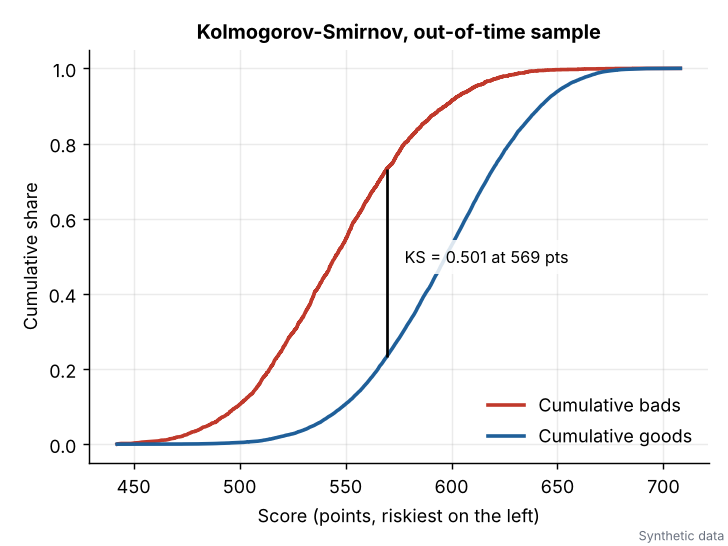
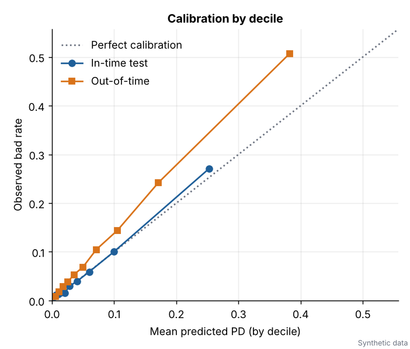
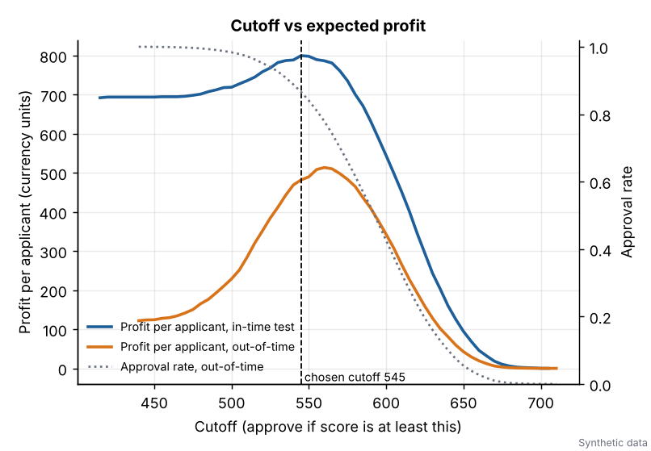

# Model Development Report: Retail Probability of Default Scorecard

> **SYNTHETIC DATA.** Every number in this document comes from a simulated portfolio with a known, planted default process. No real customers, lenders or loan performance are represented. The report shows the method, not a portfolio.

*Generated by `credit-scorecard report`. Author: Adham Karim.*

## 1. Purpose and scope

The model ranks consumer loan applicants by the probability of defaulting within 12 months of origination (default = 90 or more days past due, or worse) and converts the result into a points scorecard. Intended uses: application decisioning (accept or decline cutoff), portfolio expected loss estimation and an illustration of IFRS 9 staging. It is built as a transparent logistic regression on weight-of-evidence transformed characteristics, so every decision can be explained and every attribute has a reviewable point value.

## 2. Data

The portfolio holds 60,030 synthetic loans originated monthly from 2021-01 to 2023-12 (59,994 after cleaning). Features: age, income, employment length, debt-to-income (DTI), revolving utilisation, delinquencies in the last 24 months, credit file age, loan amount, term, purpose, home ownership and region. Loan-to-income is derived. The generator plants non-linear effects, interactions, a macro shock (unemployment rising through 2023), applicant-mix drift and not-at-random missing values (see `src/credit_scorecard/generate.py`).

| sample | origination | loans | bad rate |
|---|---|---|---|
| Development: train | 2021-01 to 2022-12 (random 70%) | 25,671 | 5.41% |
| Development: in-time test | same window (random 30%) | 11,002 | 5.64% |
| Out-of-time | 2023-01 to 2023-12 | 23,321 | 12.11% |

The out-of-time sample is never used for binning, selection, fitting or choosing the cutoff. The bad rate more than doubles from development to out-of-time, driven by the planted macro shock and the drift in applicant mix.

## 3. Data quality review

15 findings. Critical items were remediated before modelling:

| severity | check | finding |
|---|---|---|
| critical | duplicates | 30 duplicate loan_id rows (30 exact duplicates) |
| info | missingness | emp_length: 4.1% missing and the bad rate differs (11.4% vs 7.9%); missingness is informative (not random), so it gets its own scorecard bin |
| info | missingness | revol_util: 6.4% missing and the bad rate differs (12.2% vs 7.8%); missingness is informative (not random), so it gets its own scorecard bin |
| info | missingness | credit_file_age_months: 1.5% missing and the bad rate differs (12.0% vs 8.0%); missingness is informative (not random), so it gets its own scorecard bin |
| critical | range | age: 10 values outside [18, 100] |
| critical | range | income: 8 values outside [1, 5000000] |
| warning | sentinel | income: 15 rows hold sentinel-like codes [999999] |
| critical | range | emp_length: 1 values outside [0, 60] |
| critical | range | revol_util: 25 values outside [0, 3] |
| warning | sentinel | revol_util: 25 rows hold sentinel-like codes [9.99] |
| critical | domain | term: 6 rows with a non-standard term [48] |
| warning | consistency | 24 rows where employment length exceeds age minus 14 years |
| critical | leakage | max_dpd_post_orig: single-variable AUC 0.999 and a post-origination style name; treated as leakage and excluded from modelling |
| warning | vintage | 2022-03: only 235 loans vs median 1708 (possible feed gap) |
| info | vintage | bad rate rises from 4.3% (2021) to 12.1% (2023); expect calibration drift |

Remediation applied:

- dropped 30 duplicate loan_id rows
- set 10 impossible or sentinel age values to missing
- set 23 impossible or sentinel income values to missing
- set 1 impossible or sentinel emp_length values to missing
- set 25 impossible or sentinel revol_util values to missing
- set 19 inconsistent emp_length values to missing
- dropped 6 rows with a non-standard term
- dropped leakage columns: max_dpd_post_orig

Leakage screen (single-variable AUC against the default flag, top of the list):

| column | single-variable AUC | name suspect | flagged |
|---|---|---|---|
| max_dpd_post_orig | 0.999 | yes | yes |
| dti | 0.705 | no | no |
| income | 0.686 | no | no |
| revol_util | 0.683 | no | no |

`max_dpd_post_orig` is recorded after origination, so using it would leak the outcome. It is dropped. Missingness in employment length, utilisation and credit file age is informative (the bad rate differs between missing and present rows), so missing values are kept as their own scorecard bin instead of being imputed.

## 4. Methodology

### 4.1 Weight of evidence and monotonic binning

For a bin with `g` goods and `b` bads out of totals `G` and `B`, `WoE = ln((g/G) / (b/B))` and `IV = sum((g/G - b/B) * WoE)`. Numeric features start from up to 20 quantile pre-bins. The bad-rate direction is inferred, adjacent violators of the monotone trend are pooled, bins below 3% of the rows (or with fewer than 5 goods or bads) are merged into the neighbour with the closest bad rate, and any excess beyond 6 bins is removed by merging the pair that loses the least IV. Categorical levels are ordered by bad rate and merged the same way. Missing and unseen values fall into a special bin. Binning is fitted on the training sample only.

### 4.2 Feature selection

| feature | IV | strength | bins |
|---|---|---|---|
| loan_to_income | 0.476 | strong | 6 |
| income | 0.453 | strong | 6 |
| dti | 0.448 | strong | 6 |
| revol_util | 0.334 | strong | 6 |
| credit_file_age_months | 0.272 | medium | 6 |
| delinq_24m | 0.147 | medium | 3 |
| emp_length | 0.126 | medium | 6 |
| term | 0.086 | weak | 2 |
| home_ownership | 0.069 | weak | 3 |
| loan_amount | 0.061 | weak | 6 |
| purpose | 0.031 | weak | 6 |
| region | 0.009 | not useful | 6 |

Rules: keep IV of at least 0.02, then drop any feature whose absolute WoE correlation with a higher-IV feature exceeds 0.70.

- dropped `region`: IV 0.009 below 0.02

`age` is deliberately excluded from the model (regulated attribute, see section 8).

### 4.3 Logistic regression

The model is fitted by iteratively reweighted least squares (Newton-Raphson with step halving) in `model.py`; standard errors are the square roots of the diagonal of `(X'WX)^-1`, giving Wald z statistics. Because WoE is defined as `ln(good/bad)`, every coefficient of the bad-rate logit must be negative; positive signs would be pruned automatically.

| term | coef | std err | z | p value | vif |
|---|---|---|---|---|---|
| intercept | -2.874 | 0.033 | -86.1 | <0.0001 | n/a |
| loan_to_income | -0.429 | 0.087 | -4.9 | <0.0001 | 4.37 |
| income | -0.491 | 0.076 | -6.4 | <0.0001 | 3.09 |
| dti | -0.782 | 0.048 | -16.4 | <0.0001 | 1.17 |
| revol_util | -1.019 | 0.048 | -21.1 | <0.0001 | 1.01 |
| credit_file_age_months | -0.725 | 0.059 | -12.3 | <0.0001 | 1.15 |
| delinq_24m | -0.961 | 0.071 | -13.5 | <0.0001 | 1.01 |
| emp_length | -0.717 | 0.090 | -8.0 | <0.0001 | 1.04 |
| term | -0.944 | 0.101 | -9.3 | <0.0001 | 1.06 |
| home_ownership | -0.481 | 0.127 | -3.8 | 0.0002 | 1.08 |
| loan_amount | -0.616 | 0.220 | -2.8 | 0.0052 | 3.38 |
| purpose | -1.136 | 0.169 | -6.7 | <0.0001 | 1.00 |

Converged in 7 iterations on 25,671 loans; McFadden pseudo R-squared 0.203; likelihood ratio test p < 0.0001. All signs are as expected and the largest VIF is 4.37. Cross-checks: maximum absolute coefficient difference against a scipy BFGS fit is 6.4e-08 and against scikit-learn is 1.3e-06.

### 4.4 Scorecard scaling

`score = offset + factor * ln(odds_good)` with factor = PDO / ln 2 = 28.854 and offset = 501.86, so a score of 600 corresponds to odds of 30:1 (PD 3.23%) and every 20 points double the odds. The intercept is shared equally across characteristics. The full points table:

| characteristic | attribute | count | bad rate | woe | points |
|---|---|---|---|---|---|
| loan_to_income | <= 0.1109 | 6,416 | 2.3% | 0.878 | 64.0 |
| loan_to_income | (0.1109, 0.2406] | 10,265 | 3.7% | 0.397 | 58.1 |
| loan_to_income | (0.2406, 0.2974] | 2,566 | 5.5% | -0.017 | 53.0 |
| loan_to_income | (0.2974, 0.4625] | 3,849 | 8.1% | -0.428 | 47.9 |
| loan_to_income | (0.4625, 0.5991] | 1,283 | 12.5% | -0.912 | 41.9 |
| loan_to_income | > 0.5991 | 1,284 | 19.3% | -1.430 | 35.5 |
| loan_to_income | Missing / unseen | 8 | 0.0% | 0.000 | 53.2 |
| income | <= 19,300 | 1,291 | 16.0% | -1.199 | 36.2 |
| income | (19,300, 30,500] | 3,848 | 10.6% | -0.724 | 42.9 |
| income | (30,500, 42,400] | 5,149 | 6.2% | -0.149 | 51.1 |
| income | (42,400, 71,700] | 8,962 | 3.6% | 0.440 | 59.4 |
| income | (71,700, 124,600] | 5,132 | 2.3% | 0.879 | 65.6 |
| income | > 124,600 | 1,281 | 1.4% | 1.366 | 72.5 |
| income | Missing / unseen | 8 | 0.0% | 0.000 | 53.2 |
| dti | <= 0.1857 | 6,425 | 2.1% | 0.979 | 75.3 |
| dti | (0.1857, 0.247] | 3,845 | 3.2% | 0.539 | 65.3 |
| dti | (0.247, 0.3744] | 7,702 | 4.3% | 0.237 | 58.5 |
| dti | (0.3744, 0.4309] | 2,567 | 7.8% | -0.384 | 44.5 |
| dti | (0.4309, 0.576] | 3,850 | 10.2% | -0.682 | 37.8 |
| dti | > 0.576 | 1,282 | 16.1% | -1.213 | 25.8 |
| dti | Missing / unseen | 0 | n/a | 0.000 | 53.2 |
| revol_util | <= 0.1517 | 1,213 | 2.6% | 0.735 | 74.8 |
| revol_util | (0.1517, 0.5041] | 12,078 | 3.5% | 0.464 | 66.8 |
| revol_util | (0.5041, 0.6462] | 4,833 | 4.4% | 0.217 | 59.5 |
| revol_util | (0.6462, 0.7377] | 2,414 | 5.5% | -0.012 | 52.8 |
| revol_util | (0.7377, 0.7961] | 1,209 | 9.1% | -0.560 | 36.7 |
| revol_util | > 0.7961 | 2,416 | 14.8% | -1.107 | 20.6 |
| revol_util | Missing / unseen | 1,508 | 8.4% | -0.467 | 39.4 |
| credit_file_age_months | <= 25 | 1,289 | 14.8% | -1.111 | 29.9 |
| credit_file_age_months | (25, 60] | 2,523 | 9.3% | -0.584 | 41.0 |
| credit_file_age_months | (60, 102] | 3,798 | 6.4% | -0.181 | 49.4 |
| credit_file_age_months | (102, 137] | 3,835 | 5.1% | 0.056 | 54.3 |
| credit_file_age_months | (137, 224] | 7,534 | 4.1% | 0.303 | 59.5 |
| credit_file_age_months | > 224 | 6,309 | 2.8% | 0.684 | 67.5 |
| credit_file_age_months | Missing / unseen | 383 | 10.4% | -0.720 | 38.1 |
| delinq_24m | <= 0 | 19,834 | 4.4% | 0.227 | 59.5 |
| delinq_24m | (0, 1] | 4,966 | 7.9% | -0.406 | 41.9 |
| delinq_24m | > 1 | 871 | 15.0% | -1.131 | 21.8 |
| delinq_24m | Missing / unseen | 0 | n/a | 0.000 | 53.2 |
| emp_length | <= 3 | 8,172 | 7.2% | -0.309 | 46.8 |
| emp_length | (3, 5.2] | 5,474 | 5.2% | 0.035 | 53.9 |
| emp_length | (5.2, 7.2] | 3,630 | 5.0% | 0.093 | 55.1 |
| emp_length | (7.2, 10.4] | 3,714 | 3.6% | 0.416 | 61.8 |
| emp_length | (10.4, 15] | 2,458 | 3.2% | 0.554 | 64.6 |
| emp_length | > 15 | 1,202 | 2.1% | 0.974 | 73.3 |
| emp_length | Missing / unseen | 1,021 | 9.1% | -0.562 | 41.5 |
| term | <= 36 | 19,007 | 4.5% | 0.201 | 58.6 |
| term | > 36 | 6,664 | 8.1% | -0.432 | 41.4 |
| term | Missing / unseen | 0 | n/a | 0.000 | 53.2 |
| home_ownership | OWN | 3,436 | 2.9% | 0.643 | 62.1 |
| home_ownership | MORTGAGE | 6,266 | 4.5% | 0.201 | 56.0 |
| home_ownership | RENT | 15,969 | 6.3% | -0.164 | 50.9 |
| home_ownership | Missing / unseen | 0 | n/a | 0.000 | 53.2 |
| loan_amount | <= 3,280 | 1,295 | 3.6% | 0.433 | 60.9 |
| loan_amount | (3,280, 6,460] | 6,433 | 4.5% | 0.197 | 56.7 |
| loan_amount | (6,460, 11,250] | 8,960 | 5.0% | 0.080 | 54.6 |
| loan_amount | (11,250, 16,970] | 5,133 | 5.7% | -0.063 | 52.0 |
| loan_amount | (16,970, 24,750] | 2,568 | 6.9% | -0.264 | 48.5 |
| loan_amount | > 24,750 | 1,282 | 10.3% | -0.697 | 40.8 |
| loan_amount | Missing / unseen | 0 | n/a | 0.000 | 53.2 |
| purpose | auto | 2,416 | 3.9% | 0.343 | 64.4 |
| purpose | credit_card / home_improvement | 8,378 | 4.7% | 0.144 | 57.9 |
| purpose | other | 2,893 | 5.3% | 0.031 | 54.2 |
| purpose | debt_consolidation | 9,367 | 6.0% | -0.110 | 49.6 |
| purpose | medical | 1,256 | 6.4% | -0.190 | 46.9 |
| purpose | small_business | 1,361 | 7.6% | -0.371 | 41.0 |
| purpose | Missing / unseen | 0 | n/a | 0.000 | 53.2 |

## 5. Validation

### 5.1 Discrimination

| sample | n | bad rate | AUC | Gini | KS |
|---|---|---|---|---|---|
| Train | 25,671 | 5.41% | 0.821 | 0.641 | 0.496 |
| In-time test | 11,002 | 5.64% | 0.820 | 0.640 | 0.496 |
| Out-of-time | 23,321 | 12.11% | 0.828 | 0.655 | 0.501 |

Bootstrap 95% confidence intervals for AUC (400 resamples): in-time test 0.800 to 0.840; out-of-time 0.819 to 0.835. Discrimination is stable out of time (out-of-time AUC 0.828 versus 0.820 in-time).

### 5.2 Challenger comparison

Out-of-time comparison:

| model | AUC | Gini | KS |
|---|---|---|---|
| Scorecard (logistic on WoE) | 0.828 | 0.655 | 0.501 |
| Gradient boosting (raw features) | 0.831 | 0.662 | 0.502 |
| Oracle (true planted PD, unattainable) | 0.848 | 0.696 | 0.535 |

The boosted model gains 0.0035 AUC (95% paired bootstrap interval 0.0004 to 0.0065). The scorecard gives up very little discrimination while remaining fully transparent, with auditable points and reason codes. The boosted model also overfits more: its train to test AUC gap is 0.041 against 0.001 for the scorecard.

### 5.3 Calibration

Out-of-time decile table (band 1 = lowest predicted PD):

| band | n | bads | mean PD | observed | obs / pred |
|---|---|---|---|---|---|
| 1 | 2,333 | 19 | 0.54% | 0.81% | 1.50 |
| 2 | 2,332 | 41 | 1.11% | 1.76% | 1.58 |
| 3 | 2,332 | 66 | 1.74% | 2.83% | 1.63 |
| 4 | 2,332 | 88 | 2.51% | 3.77% | 1.51 |
| 5 | 2,332 | 124 | 3.52% | 5.32% | 1.51 |
| 6 | 2,332 | 160 | 4.97% | 6.86% | 1.38 |
| 7 | 2,332 | 244 | 7.12% | 10.46% | 1.47 |
| 8 | 2,332 | 336 | 10.53% | 14.41% | 1.37 |
| 9 | 2,332 | 564 | 17.10% | 24.19% | 1.41 |
| 10 | 2,332 | 1,182 | 38.22% | 50.69% | 1.33 |

Hosmer-Lemeshow: in-time test chi-square 14.5 (p = 0.070); out-of-time 395.7 (p = 1.5e-80). Ranking holds but the LEVEL of risk drifted: mean predicted PD is 8.7% against an observed 12.1% because the macro shock raises defaults beyond what the development window could teach. A single logit shift of +0.45 restores calibration-in-the-large (Hosmer-Lemeshow chi-square 9.7 afterwards). In practice the points table stays fixed and the PD mapping is recalibrated, or the model is rebuilt on newer vintages.

### 5.4 Lift and gains

Out-of-time, band 1 = riskiest 10% of applicants:

| band | n | bads | bad rate | lift | cumulative bads captured |
|---|---|---|---|---|---|
| 1 | 2,332 | 1,182 | 50.7% | 4.19 | 41.9% |
| 2 | 2,332 | 564 | 24.2% | 2.00 | 61.8% |
| 3 | 2,332 | 336 | 14.4% | 1.19 | 73.7% |
| 4 | 2,332 | 244 | 10.5% | 0.86 | 82.4% |
| 5 | 2,332 | 160 | 6.9% | 0.57 | 88.0% |
| 6 | 2,332 | 124 | 5.3% | 0.44 | 92.4% |
| 7 | 2,332 | 88 | 3.8% | 0.31 | 95.5% |
| 8 | 2,332 | 66 | 2.8% | 0.23 | 97.9% |
| 9 | 2,332 | 41 | 1.8% | 0.15 | 99.3% |
| 10 | 2,333 | 19 | 0.8% | 0.07 | 100.0% |

### 5.5 Stability (PSI)

| item | PSI | reading |
|---|---|---|
| SCORE (train vs out-of-time) | 0.163 | moderate shift |
| loan_to_income | 0.010 | stable |
| income | 0.037 | stable |
| dti | 0.160 | moderate shift |
| revol_util | 0.267 | significant shift |
| credit_file_age_months | 0.004 | stable |
| delinq_24m | 0.032 | stable |
| emp_length | 0.001 | stable |
| term | 0.000 | stable |
| home_ownership | 0.002 | stable |
| loan_amount | 0.003 | stable |
| purpose | 0.006 | stable |

Sanity check: train vs in-time test score PSI is 0.0013. Conventional reading: below 0.10 stable, 0.10 to 0.25 moderate shift, above 0.25 significant shift. The out-of-time score shows a moderate shift, driven by higher utilisation and DTI in newer vintages.

## 6. Business layer

> Simplified, illustrative economics on synthetic data. Not a forecast.

Assumptions: net interest margin 5.5% per year on an average balance of 55% of the loan amount over the term; LGD 70%; EAD 85% of the original amount. A performing loan earns margin over its term, a defaulted loan loses EAD x LGD. Profit is in abstract currency units.

### 6.1 Cutoff analysis

In-time test sample, selected cutoffs:

| cutoff | approval rate | bad rate (approved) | profit per applicant |
|---|---|---|---|
| 500 | 99.5% | 5.34% | 719 |
| 520 | 98.2% | 4.80% | 759 |
| 540 | 95.2% | 3.95% | 789 |
| 560 | 88.1% | 3.03% | 787 |
| 580 | 76.3% | 2.24% | 701 |
| 600 | 58.7% | 1.53% | 544 |
| 620 | 38.4% | 1.23% | 346 |
| 640 | 19.5% | 1.03% | 160 |
| 660 | 6.3% | 0.87% | 46 |

The profit-maximising cutoff on the in-time test sample is 545 points (93.9% approved, bad rate among approved 3.67%). Applied unchanged to the out-of-time sample it approves 86.6% with a bad rate of 7.04% and total profit 11,238,427, against 2,842,990 if everyone were approved. The cutoff was not re-tuned for the macro shock: the riskier out-of-time population lowers the approval rate and lifts the bad rate among approved loans, which is why cutoffs should be reviewed whenever calibration drifts.

### 6.2 Expected loss by score band

`EL = PD x LGD x EAD`, out-of-time sample, bands from development score deciles (model PD, before recalibration):

| band | n | avg PD | observed bad rate | ead | expected loss | EL rate | loss at observed defaults |
|---|---|---|---|---|---|---|---|
| min to 556 | 4,527 | 28.10% | 37.95% | 47,596,073 | 9,861,398 | 20.72% | 13,040,508 |
| 556 to 574 | 3,275 | 10.02% | 13.98% | 30,235,698 | 2,128,972 | 7.04% | 2,933,160 |
| 574 to 588 | 2,833 | 6.06% | 8.68% | 25,784,504 | 1,095,525 | 4.25% | 1,569,705 |
| 588 to 599 | 2,462 | 4.05% | 5.61% | 21,000,584 | 596,812 | 2.84% | 860,251 |
| 599 to 608 | 2,211 | 2.88% | 4.52% | 18,600,864 | 375,558 | 2.02% | 613,261 |
| 608 to 618 | 2,118 | 2.09% | 3.26% | 17,595,518 | 257,064 | 1.46% | 393,259 |
| 618 to 628 | 1,871 | 1.49% | 2.51% | 15,067,380 | 157,299 | 1.04% | 224,583 |
| 628 to 639 | 1,561 | 1.05% | 1.79% | 12,038,958 | 88,194 | 0.73% | 174,109 |
| 639 to 653 | 1,403 | 0.70% | 0.78% | 10,795,102 | 52,770 | 0.49% | 70,436 |
| 653 to max | 1,060 | 0.38% | 0.85% | 7,727,154 | 20,604 | 0.27% | 51,354 |
| Total | 23,321 | 8.74% | 12.11% | 206,441,838 | 14,634,197 | 7.09% | 19,930,626 |

Expected loss under-shoots the loss implied by observed defaults, the same calibration drift seen in section 5.3.

### 6.3 IFRS 9 style staging (ILLUSTRATIVE ONLY)

This is not an IFRS 9 implementation. A reporting-date PD is simulated from the origination PD with a seeded migration factor. Stage 3 = defaulted. Stage 2 = PD at least doubled and up at least 1 percentage point, or a simulated 30 days past due backstop. Stage 1 = the rest. Stage 1 uses the 12-month PD, stage 2 a lifetime PD (constant hazard over half the term), stage 3 uses PD = 100%. No discounting, no forward-looking scenarios.

| stage | n | share | ead | ECL | coverage |
|---|---|---|---|---|---|
| 1 | 18,155 | 77.8% | 157,473,737 | 8,181,669 | 5.20% |
| 2 | 2,342 | 10.0% | 20,495,778 | 3,993,618 | 19.49% |
| 3 | 2,824 | 12.1% | 28,472,322 | 19,930,626 | 70.00% |

Total ECL 32,105,913 on EAD 206,441,838 (15.55%).

## 7. Reason codes (adverse action)

For each applicant the three characteristics where the applicant lost the most points against the best attainable attribute are returned, mapped to plain-language reason text. Example: the three lowest scoring out-of-time applicants.

| loan_id | score | pd | reason_1 | reason_2 | reason_3 |
|---|---|---|---|---|---|
| L045263 | 442 | 88.8% | R02 High utilisation of revolving credit (-54 pts) | R01 Recent delinquencies on credit accounts (-38 pts) | R06 Short credit history (-38 pts) |
| L048678 | 442 | 88.7% | R02 High utilisation of revolving credit (-54 pts) | R03 High debt relative to income (-50 pts) | R01 Recent delinquencies on credit accounts (-38 pts) |
| L048006 | 443 | 88.4% | R02 High utilisation of revolving credit (-54 pts) | R03 High debt relative to income (-50 pts) | R01 Recent delinquencies on credit accounts (-38 pts) |

## 8. Fairness and governance

- **Protected attributes are not used.** Sex, race, ethnicity, religion, marital status and national origin are neither in the data nor in the planted process.
- **Age is a regulated attribute.** It is collected and used for monitoring only; it is excluded from the model, and the planted process does not use it directly (it acts only through employment length and credit file age).
- **Proxy risk remains.** Region and housing status can proxy for protected classes in real data, and age leaks in through legitimate credit factors. The screen below shows exactly that effect on synthetic data.

Illustrative adverse impact screen, out-of-time approval at cutoff 545 by age band:

| group | n | approval rate | impact ratio |
|---|---|---|---|
| under 30 | 4,974 | 70.2% | 0.73 |
| 30 to 44 | 10,229 | 88.7% | 0.93 |
| 45 to 61 | 7,231 | 93.8% | 0.98 |
| 62 and over | 884 | 95.6% | 1.00 |

A ratio below 0.80 (the four-fifths rule of thumb) prompts investigation; it is not a verdict. Here younger applicants are approved less often because they have shorter files and employment histories, which carry real risk signal in the planted process. A real review would test whether a less discriminatory alternative exists.

What a bank would additionally do: full disparate impact and disparate treatment testing with proper (and legally permitted) demographic data or proxy methods such as BISG, search for less discriminatory alternatives, legal review of every characteristic and of the reason code wording, adverse action notice workflows, model risk management approval and independent validation, documented overrides policy, and periodic re-testing after every recalibration.

## 9. Limitations

- **Synthetic data.** Results demonstrate method and tooling. Real portfolios have messier data, and real discrimination is usually lower than a simulation suggests.
- **The planted process is logistic.** That structurally favours a logistic scorecard; a real challenger comparison could look different.
- **Single 12-month default flag.** No right-censoring, roll rates, cure behaviour or behavioural scoring.
- **No reject inference.** All applicants are assumed to have observed outcomes.
- **Simplified economics.** No prepayment, discounting, collection cost, recovery timing, funding curve or pricing by risk.
- **Macro handled crudely.** One unemployment path, no scenarios, no through-the-cycle PD, and calibration drift is shown rather than modelled.
- **IFRS 9 section is a sketch.** Simulated migration, no discounting and no forward-looking information.
- **Bootstrap intervals** reflect sampling noise of the evaluation sample only, not re-estimation of the bins and coefficients.

## 10. Monitoring plan

| metric | frequency | amber | red |
|---|---|---|---|
| Score PSI vs development | Monthly | 0.10 | 0.25 |
| Characteristic PSI (each) | Monthly | 0.10 | 0.25 |
| Gini on seasoned vintages (12m performance) | Quarterly | relative drop over 5% | relative drop over 10% |
| Observed / predicted bad rate (overall and by band) | Quarterly | outside 0.8 to 1.25 | outside 0.67 to 1.5 |
| Missing rate and out-of-range counts per field | Monthly | doubles | new sentinel or schema change |
| Approval rate and override rate at cutoff | Monthly | moves over 5 pts | moves over 10 pts |
| Adverse impact ratios by monitored group | Quarterly | below 0.90 | below 0.80 |

Any red item triggers investigation and a documented decision: recalibrate the PD mapping, adjust the cutoff, or redevelop. Full revalidation is annual, or sooner after a material change in product, channel or macro regime.

## 11. Reproducibility

Everything is regenerated by `credit-scorecard run-all` (seed 20260101, 60,000 base loans). The planted data quality problems are: 30 duplicated loan rows, 10 impossible ages, 8 negative incomes, 15 income sentinel codes, 25 utilisation sentinel codes, 20 employment lengths longer than the borrower's working life, 6 invalid terms, a leaky post-origination column and one month with a simulated feed outage.

